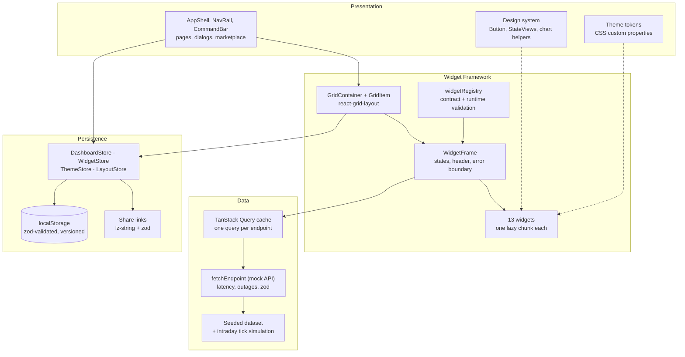
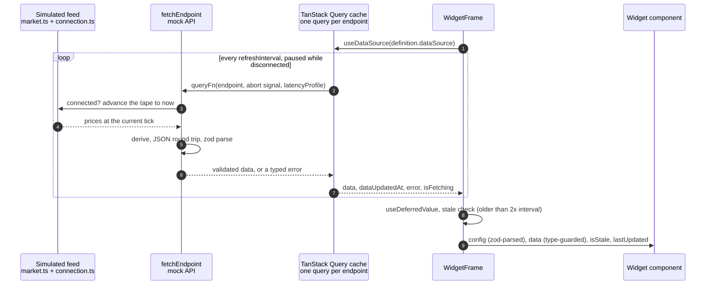
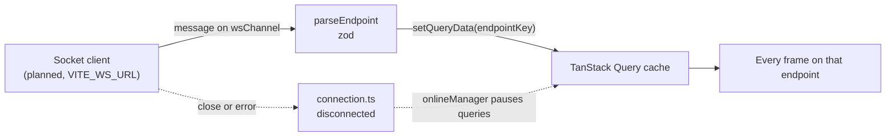
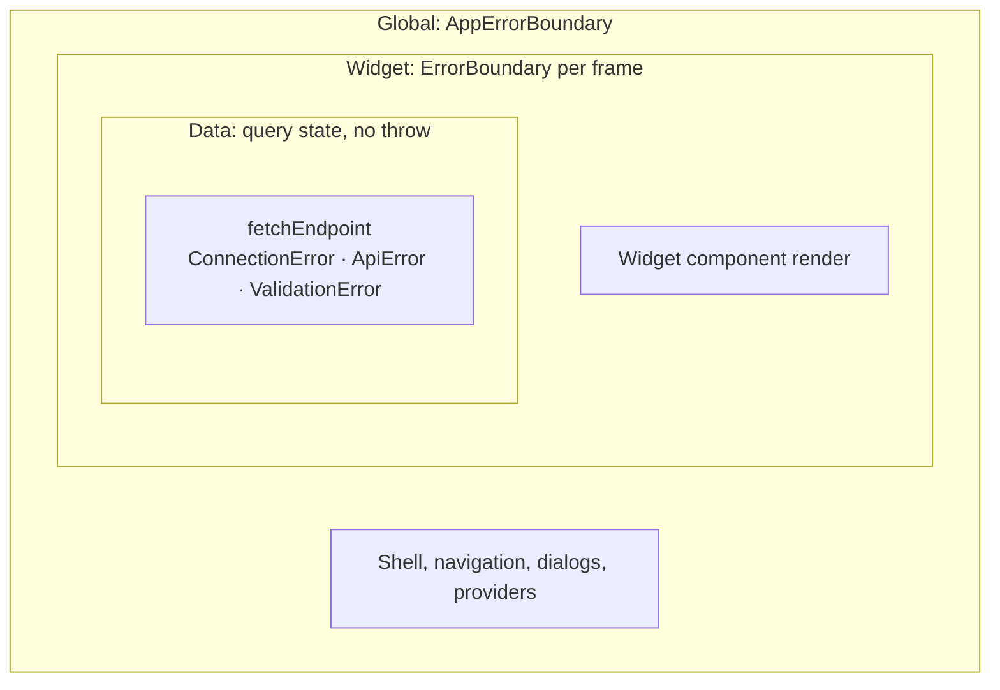

# Architecture

Meridian Capital · Portfolio Intelligence is a single-page React 18 app (Vite, strict
TypeScript). Every number on screen comes from a seeded simulation in the browser; nothing is
live. This document explains how the app is put together and why, for reviewers and for
developers joining the codebase.

1. [Four tiers](#1-four-tiers)
2. [The widget contract](#2-the-widget-contract), compared with Grafana's `PanelPlugin`
3. [State: Zustand, and why four stores](#3-state-zustand-and-why-four-stores)
4. [Data flow: feed → React Query cache → widget](#4-data-flow-feed--react-query-cache--widget)
5. [Error boundary hierarchy](#5-error-boundary-hierarchy-global--widget--data)
6. [Adding a widget in under four hours](#6-adding-a-widget-in-under-four-hours)
7. [Reference](#7-reference): domain types, sharing, theming, security, accessibility

## 1. Four tiers



| Tier             | Folders                                                | Responsibility                                                                                            |
| ---------------- | ------------------------------------------------------ | --------------------------------------------------------------------------------------------------------- |
| Presentation     | `src/layout`, `src/components`, `src/theme`            | App shell, pages, dialogs, the design system and theme tokens. No business data.                          |
| Widget Framework | `src/registry`, `src/grid`, `src/widgets`, `src/types` | The `WidgetDefinition` contract, the registry, the grid, the frame around every widget, and the widgets.  |
| Data             | `src/data`, `src/hooks/useEndpoint.ts`, TanStack Query | The seeded dataset, market simulation, mock API, response validation and the server-state cache.          |
| Persistence      | `src/store`                                            | The four Zustand stores, their localStorage persistence and migrations, layout snapshots and share links. |

Rules that keep the tiers apart:

- The Data tier imports nothing from the other tiers. Swapping the mock API for a real one is
  a change to `src/data` only.
- Widget components never fetch and never read stores. They receive `config` and `data` as
  props from `WidgetFrame`. Two small hooks are the exceptions: opening the symbol drawer
  (`useSymbolDetail`) and alert acknowledgements (`useAlertAcknowledgements`).
- Server data lives only in the TanStack Query cache. The stores hold user state (layouts,
  settings, theme, saved layouts), so persisted state and share links never contain datasets.

### Presentation: routes and design system

Routing uses `react-router-dom` 6 with a `HashRouter`, so every page is deep-linkable on any
static host and share links keep the `#/<page>?share=…` form. `src/layout/AppRoutes.tsx` holds
the route table: `AppShell` is the layout route (nav rail, command bar, dialogs, keyboard
shortcuts) and renders the page through `<Outlet>`. The pages in `src/layout/pages/` are lazy
chunks: `/:pageId` (the five dashboards; the grid and react-grid-layout load with it),
`/marketplace` and `/settings`. Unknown paths redirect to `/workstation`. Components use
`useAppRoute()` rather than the router hooks directly.

The design system has three layers:

- **Tokens.** Colours are per theme (`src/theme/themes.ts`). Spacing (a 4 px unit, kept in
  rem), radii (2, 4 and 6 px), the 1 px divider and the font stacks are structural custom
  properties in `src/theme/global.css`. Tailwind's spacing, border-radius, border-width and font
  scales point at these variables (`src/theme/tokens.ts`), so `p-3` is
  `calc(var(--space-unit) * 3)`. Numbers use the `.num` class (Inter, `tabular-nums`).
- **Primitives** in `src/components`: `Button` (primary, secondary, ghost, danger; sm, md, lg;
  `loading`; icon), `IconButton` (always labelled, with a tooltip), `Tooltip`, `Badge`, `Tabs`
  (WAI-ARIA tabs), `Toggle` (`role="switch"`) and `Dropdown` (WAI-ARIA menu button with arrow
  keys, Home and End, type-ahead and focus return), plus overlays, form controls and state
  views. Each has stories and unit tests.
- **Shell.** A 56 px icon rail and a 44 px command bar. Panels are flat (1 px borders, small
  radii, no gradients, glass or large cards) so the grid gets the space.

## 2. The widget contract

`src/types/widget.ts` defines the contract. Its field names are fixed by the brief:

```ts
interface WidgetDefinition<TConfig = WidgetConfig, TData = unknown> {
  id: string; // kebab-case, unique in the registry
  name: string;
  description: string;
  category: WidgetCategory; // CHART | TABLE | FEED | GAUGE | ANALYSIS
  defaultSize: GridSize; // grid units on the default grid (12 columns, 60 px rows)
  minSize: GridSize;
  maxSize?: GridSize;
  configSchema: JSONSchema7; // drives the settings form
  defaultConfig: TConfig; // one value per configSchema property
  component: LazyExoticComponent<WidgetComponentType<TConfig, TData>>;
  icon: ComponentType;
  dataSource: DataSourceConfig; // { endpoint, wsChannel?, refreshInterval, latencyProfile }
}
```

The component receives `WidgetComponentProps`: `instanceId`, `config`, `data`, `isLoading`,
`error`, `isStale`, `lastUpdated` (IST ISO), `onConfigChange(patch)`, `width` and `height`. A
placed widget is a `WidgetInstance`: `{ instanceId, widgetId, config, position: { x, y, w, h } }`.

### Why it is shaped this way

- **A definition is plain data.** No class, no builder, no hidden state. It can be read top to
  bottom, checked at runtime, and listed in the marketplace without loading the component.
- **The component is always `React.lazy`.** Every widget is its own chunk (budget: 50 KB gzip).
  The registry, the marketplace and search only need the small definition objects.
- **Settings are JSON Schema.** The settings drawer generates its form from `configSchema`, and
  the same schema validates settings (`validateWidgetConfig`). JSON Schema is data, so it could
  be stored or validated by a backend unchanged. Each widget also has a zod schema
  (`configParser`) that gives the component typed config at runtime; stored values that fail it
  fall back to their defaults one key at a time.
- **Each widget declares exactly one typed data source.** `TData` is the validated response of
  that endpoint, for example `HoldingsData`, so the widget works with domain fields (`ticker`,
  `weight`, `dailyPnL`) with no transform layer.
- **The frame owns every state.** Loading skeleton, error with Retry, "No data available",
  stale marker and the disconnected state are drawn by `WidgetFrame`, not by widgets. A widget
  only draws data. `isLoading`, `error` and `isStale` are passed for background refreshes, where
  the widget still shows the last good data.
- **Sizes belong to the widget.** `defaultSize`, `minSize` and `maxSize` let the marketplace
  place a new widget and the grid enforce limits without any dashboard file. They are written
  for the default grid and converted to the user's grid settings when used.

### Compared with Grafana's `PanelPlugin`

Grafana is the closest well-known design: a panel plugin is
`new PanelPlugin<Options>(PanelComponent).setPanelOptions((builder) => …)`, its metadata lives
in `plugin.json`, and the component receives `PanelProps` (`data`, `options`, `width`,
`height`, `onOptionsChange`, `timeRange`, …). The comparison below is with Grafana's public
plugin API.

| Concern                  | Grafana `PanelPlugin`                                                                                       | Meridian `WidgetDefinition`                                                                                      | Why Meridian differs                                                                                                                                                                   |
| ------------------------ | ----------------------------------------------------------------------------------------------------------- | ---------------------------------------------------------------------------------------------------------------- | -------------------------------------------------------------------------------------------------------------------------------------------------------------------------------------- |
| Declaration              | A class instance configured with a fluent builder; metadata in `plugin.json`                                | One plain object (contract fields only)                                                                          | Easy to validate at runtime and to read in review. The cost: no builder conveniences such as conditional options.                                                                      |
| Settings                 | Options declared in code with the builder (`addTextInput`, `addBooleanSwitch`, …), which renders the editor | `configSchema` (JSON Schema 7) for the form and validation, plus a zod parser for types                          | Settings are data that can be validated and stored outside the UI. The cost: two descriptions of the same settings. The registry test checks that the defaults satisfy both.           |
| Data                     | Queries belong to the panel in the dashboard and run through a data source plugin; panels get `DataFrame`s  | One endpoint per widget (`dataSource.endpoint`); the widget gets that endpoint's typed, zod-validated response   | One known dataset and typed domain shapes. Grafana's model lets any panel show any query; that flexibility is not needed here, and typed data removes a whole class of transform bugs. |
| States                   | Shared panel chrome shows loading and error states                                                          | `WidgetFrame` shows skeleton, error, empty, stale and disconnected states                                        | Same idea. The brief requires the same set of states on every widget, so the frame guarantees them.                                                                                    |
| Loading                  | Plugin bundles are loaded at runtime                                                                        | Registered at build time in `src/registry/registry.ts`; each component is a lazy chunk from the app's own origin | The CSP (`script-src 'self'`) allows no third-party code, and build-time registration lets TypeScript check every widget.                                                              |
| Changes to saved options | A migration handler on the plugin (`setMigrationHandler`)                                                   | Per-key fallback to defaults (`resolveWith`) plus versioned migrations of persisted stores                       | Settings are small and flat, so dropping one invalid value is safer than failing the widget.                                                                                           |

### Registration and validation

`defineWidget(definition, { configParser, isData, summarize, skeleton, preload, isEmpty? })`
turns a typed definition into a `RegisteredWidget`: a type-erased `WidgetDefinition` whose
`component` checks config (zod) and data (type guard) before rendering the widget's typed
component, plus the helpers the frame needs. This is how widgets with different config and
data types share one registry without `any` or unchecked casts.

`WidgetRegistry<T extends WidgetDefinition>` (`src/registry/WidgetRegistry.ts`) is backed by a
`Map<string, T>`: `registerWidget`, `getWidget`, `hasWidget`, `getAllWidgets` (registration
order), `getWidgetsByCategory`, `unregisterWidget` and `validateConfig(id, config)`. The app
uses one singleton, `widgetRegistry`.

- A duplicate id throws `DuplicateWidgetError`.
- `validateWidgetDefinition` checks every contract field at runtime: kebab-case id, non-empty
  name and description, a known category, positive integer sizes with
  `minSize ≤ defaultSize ≤ maxSize`, a `configSchema` that uses only supported keywords,
  exactly one valid default per schema property, a `React.lazy` component, an icon component,
  a known endpoint, a refresh interval of at least 1 s and a latency profile. Failures throw
  `InvalidWidgetDefinitionError` with one line per problem.
- In development and tests a broken built-in widget stops start-up. In production it is logged
  and skipped, and its instances show "Widget unavailable".

`validateWidgetConfig(config, configSchema)` implements the JSON Schema draft-7 keywords widget
settings need (`type`, `properties`, `required`, `additionalProperties`, `enum`, `const`,
`oneOf`, `anyOf`, `allOf`, numeric bounds, `multipleOf`, string lengths, `pattern`). Any other
keyword makes validation fail rather than be skipped. Ajv is not used because it compiles
validators with `new Function`, which the CSP blocks.

## 3. State: Zustand, and why four stores

### Why Zustand rather than Redux

Server data is handled by TanStack Query (section 4), so the client state left over is small:
layouts, widget settings, theme and saved layouts. For that, Zustand fits better:

- **No provider.** Stores are plain modules. Cross-store actions, the theme sync (which runs
  outside React) and tests use `getState()` directly.
- **Narrow subscriptions.** Components select small slices (`useShallow` when several fields
  are needed), so dragging a widget does not re-render the theme menu or widget bodies.
- **Middleware covers what Redux Toolkit would give us.** `immer` for readable updates,
  `devtools` for the Redux DevTools extension (development only, `VITE_ENABLE_DEVTOOLS=true`),
  and `persist` with a custom storage that validates everything it reads with zod and runs
  versioned migrations.
- **Less ceremony.** A store is its state plus the functions that change it, with no action
  types, reducers or slices.

What we give up: Redux keeps everything in one store, so an update that spans concerns is one
atomic dispatch and time-travel debugging covers all state. With several stores, operations
that change two stores run in a fixed order instead (see below).

### Why four stores

| Store            | Owns                                                                                                        | Persisted under      |
| ---------------- | ----------------------------------------------------------------------------------------------------------- | -------------------- |
| `DashboardStore` | `gridConfig`, layouts per page and breakpoint, widget order, lock, display currency, acknowledged alert ids | `meridian:dashboard` |
| `WidgetStore`    | widget instances keyed by `instanceId` (type, title, settings, position); which settings drawer is open     | `meridian:widgets`   |
| `ThemeStore`     | active theme id, custom themes, theme builder draft (live preview)                                          | `meridian:theme`     |
| `LayoutStore`    | `savedLayouts` with up to 20 versions each, active layout per page, the last 10 `shares`                    | `meridian:layouts`   |

The split follows how often each kind of state changes and how bad it is to lose it:

- **Writes stay small.** `persist` serialises a store's whole persisted state on every change.
  A drag fires many layout updates; keeping saved layouts (up to 30 × 20 versions) in their own
  store means those updates never re-write the version history.
- **Failures stay contained.** Each store is validated and migrated on its own. A corrupt or
  outdated theme entry is discarded without touching layouts, and the reverse.
- **Different readers.** The theme store is read outside React by `startThemeSync`; the grid
  reads layouts from DashboardStore and only widget types from WidgetStore; each widget frame
  reads its own instance.

Operations that touch two stores live in `src/store/actions.ts` (`addWidgetToPage`,
`removeWidgetFromPage` with `restoreRemovedWidget`, `duplicateWidget`, `applyGridConfig`,
`captureSnapshot`, `applySnapshot`, `resetPage`). Their order is chosen so the grid never
points at a missing instance: adding creates the instance before placing it, and removing
takes it off the grid before deleting it.

Actions per store (each has a unit test in `src/__tests__/<store>-store.test.ts`):

- **DashboardStore**: `setGridConfig`, `resetGridConfig`, `addWidget`, `removeWidget`,
  `restoreWidget`, `moveWidget`, `resizeWidget`, `setLayouts`, `replacePage`, `setLocked`,
  `setDisplayCurrency`, `acknowledgeAlerts`.
- **WidgetStore**: `createInstance`, `upsertInstances`, `updateConfig`, `replaceConfig`,
  `renameInstance`, `setPositions`, `removeInstances`, `duplicateInstance`, `openSettings`,
  `closeSettings`.
- **ThemeStore**: `setActiveTheme`, `openBuilder`, `closeBuilder`, `setDraftToken`,
  `setDraftName`, `setDraftMode`, `saveDraft`, `deleteCustomTheme`, `importTheme`.
- **LayoutStore**: `saveLayout`, `saveVersion`, `renameLayout`, `deleteLayout`, `setActive`,
  `recordShare`, `removeShare`, `clearShares`.

### Grid settings

`gridConfig` holds `cols` (6 to 24, default 12), `rowHeight` (30 to 100 px, default 60), `gap`
(4 to 20 px, default 8) and `compaction` (`vertical` or `none`). `setGridConfig` validates the merged settings
with zod and converts every page's layouts so widgets keep their width share and roughly their
pixel height. `moveWidget`, `resizeWidget` and `addWidget` keep layouts valid on their own
(inside the columns, no overlaps, compacted when `vertical`) using the pure helpers in
`src/utils/gridLayout.ts`. Per-widget minimum and maximum sizes are enforced by
react-grid-layout in the UI.

### The grid: GridContainer, GridItem, GridToolbar

`GridContainer` (`src/grid/GridContainer.tsx`) is react-grid-layout's `Responsive` grid wrapped
in `WidthProvider`. It reads columns, row height, gap and compaction from DashboardStore and has
three breakpoints, each with its own layout stored in DashboardStore:

| Breakpoint | Viewport    | Columns                        |
| ---------- | ----------- | ------------------------------ |
| `desktop`  | ≥ 1280 px   | `gridConfig.cols` (default 12) |
| `tablet`   | 768–1279 px | 6                              |
| `mobile`   | < 768 px    | 1 (stacked)                    |

- **Breakpoints follow the viewport.** react-grid-layout chooses a breakpoint from the grid's
  own width, which is about 100 px narrower than the window here (nav rail, padding,
  scrollbar). `breakpointForViewport` decides from `window.innerWidth`, and
  `gridBreakpointsFor` passes thresholds that make react-grid-layout select that breakpoint at
  any grid width. Checked in Chrome at 3840, 2560, 1920, 1440, 1280, 1279, 1000, 768, 767 and
  500 px: the switch happens at exactly 1280 and 768, with no overlaps and no horizontal scroll.
- **Independent layouts.** The first time a breakpoint is shown without a stored layout, one is
  derived from the desktop layout (`deriveLayout`: widths capped at the columns, overlaps
  settled; one column stacks everything) and stored. After that each breakpoint changes on
  its own.
- **No overlaps.** `preventCollision` and `allowOverlap` are off, so a dragged or resized
  widget pushes the others away. Compaction is vertical by default; the toolbar switches it
  to none (free placement).
- **`measureBeforeMount` is not used.** In react-grid-layout 1.5 it measures a temporary
  element that is then replaced, and its ResizeObserver reports the removed node as 0 px wide,
  collapsing every widget. jsdom's fake ResizeObserver hides this, so it was found in the
  browser.

`GridItem` is the cell wrapper: react-grid-layout clones it to add position styles, handlers
and the resize handle, so it forwards its ref and props. Each cell renders a `WidgetFrame`, or a
`PlaceholderCard` for an empty slot.

`GridToolbar` (in the page header) has **Add widget**, which puts an empty slot (a
`__placeholder` instance, 4 × 3 on the default grid) at the first free position
(`findFreePosition`: rows top to bottom, columns left to right, else the bottom). The slot can
be moved and resized; **Choose widget** turns it into any registered widget in place, growing
it to at least that widget's default size. Saved layouts and share links keep empty slots. The
toolbar also links to the marketplace, toggles compaction and shows the active breakpoint.

Snapshots (saved versions and share links) record the grid they were captured on and are
converted when applied. Data saved before grid settings existed used 12 columns and 28 px rows;
the version 2 persist migrations convert it, and snapshots without a grid are read as that old
grid. Layouts saved with the earlier `lg`/`md`/`sm`/`xs` breakpoints are read through
`BreakpointLayoutsSchema`: `lg` becomes `desktop`, `sm` (6 columns) becomes `tablet`, and `md`
and `xs` are dropped and derived again.

## 4. Data flow: feed → React Query cache → widget

There is no WebSocket in the current build. The "live feed" is a simulation that runs in the
browser, and widgets receive it by polling through TanStack Query. The contract already carries
a `wsChannel` per widget so a socket can be added without changing widgets; that planned path
is described after the current one.

### What runs today



1. **Feed.** `src/data/dataset.ts` builds one seeded dataset (five years of daily history).
   `src/data/market.ts` advances intraday prices by geometric Brownian motion, one step per
   tick (`VITE_TICK_INTERVAL_MS`, default 5 s), each tick from its own seeded generator, so the
   price at a given moment is the same in every widget, tab and reload. `src/data/connection.ts`
   combines the browser's online flag with a "simulate outage" switch.
2. **Mock API.** `fetchEndpoint` waits the simulated latency (`VITE_API_LATENCY_MS` ×
   `latencyProfile`: low ×0.4, normal ×1, high ×2.5, plus jitter). It throws `ConnectionError`
   when the feed is down, and `ApiError` at `VITE_MOCK_ERROR_RATE`. Otherwise it derives the
   response, serialises it to JSON and back as a network response would be, and validates it
   with zod (`ValidationError` on failure). Validated objects are recorded in a `WeakMap`, which
   is what the widget's `isData` guard checks.
3. **Query cache.** `useEndpoint` keys each query by endpoint (`['endpoint', id]`). Widgets on
   the same endpoint share one cached response, so totals agree and requests are de-duplicated;
   the shortest refresh interval among them drives refetches. `onlineManager` follows the
   connection state, so polling pauses during an outage and refetches on reconnect. Failed
   requests retry twice, 800 ms apart, except validation failures, which are deterministic.
4. **Frame and widget.** `WidgetFrame` defers new data (`useDeferredValue`) so renders can be
   split across frames, marks data older than twice the refresh interval as stale, picks the
   state to show, and renders the registered component, which checks config and data before
   handing them to the widget.

### Planned WebSocket path (not built)



A socket client would subscribe to the `wsChannel`s of mounted widgets, validate each message
with the same `parseEndpoint`, and write it into the cache with
`queryClient.setQueryData(endpointKey(endpoint), data)`. Every frame on that endpoint would
re-render exactly as it does after a poll, and polling would drop to a slow heartbeat. A closed
socket would set the connection state to disconnected, which already pauses queries and shows
the disconnected state. Widgets, the frame and the stores would not change. `VITE_WS_URL` and
`wsChannel` are reserved for this; nothing opens a socket today.

## 5. Error boundary hierarchy: Global > Widget > Data



| Level  | Where                                                           | Catches                                                       | What the user sees                                                                                                                               | Recovery                                                                                                             |
| ------ | --------------------------------------------------------------- | ------------------------------------------------------------- | ------------------------------------------------------------------------------------------------------------------------------------------------ | -------------------------------------------------------------------------------------------------------------------- |
| Global | `AppErrorBoundary`, outside every provider (`src/App.tsx`)      | Render errors in the shell, navigation, dialogs or a provider | A full-page message with the error text; layouts and settings are untouched                                                                      | **Try again** re-renders the app; **Reload page**                                                                    |
| Widget | `ErrorBoundary` around each widget's `Suspense` (`WidgetFrame`) | Render errors in one widget, including a failed chunk load    | That widget shows "This widget failed to render: …" with Retry; every other widget keeps working                                                 | Retry resets the boundary and refetches; it also resets by itself when new data or new settings arrive (`resetKeys`) |
| Data   | Query state, read by `WidgetFrame`                              | Network, outage and validation errors from `fetchEndpoint`    | First load: error state with Retry, or the disconnected state. Later failures: last good data stays, with the stale marker after 2× the interval | Automatic retries (twice, not for validation errors), Retry button, automatic refetch on reconnect                   |

Data errors never become React errors: TanStack Query turns a rejected request into query state,
and the frame draws it. Problems that could still reach a widget are handled before render:
settings that fail the widget's zod schema fall back to defaults, and data that fails the
`isData` guard shows "Received data in an unexpected shape" instead of throwing.

React error boundaries do not see errors in event handlers or async code. Handlers that can
fail handle their own errors: copying a share link and importing layout or theme files show a
message instead.

`src/__tests__/error-boundaries.test.tsx` covers all three levels: a shell error shows the
global page and recovers, a crashing widget is contained while its neighbour renders, and a
failed request shows the widget's error state without reaching any boundary.

## 6. Adding a widget in under four hours

A widget is one new folder plus two one-line registrations. Nothing in `src/grid`,
`src/store`, `src/data`, `src/layout` or `src/theme` changes, provided an existing endpoint has
the data you need. If it does not, stop: a new endpoint (derivation, zod schema, mock API entry)
is a data-layer change and needs its own review.

The times below are estimates for a developer new to the codebase, not measurements.

| Step | Time   | What to do                                                                                                                                                                                                                                                                                               |
| ---- | ------ | -------------------------------------------------------------------------------------------------------------------------------------------------------------------------------------------------------------------------------------------------------------------------------------------------------- |
| 1    | 15 min | Pick the endpoint. Read `ENDPOINTS` in `src/data/endpoints.ts`, the response types in `src/data/schemas.ts` and the domain types in `src/types/domain.ts`.                                                                                                                                               |
| 2    | 10 min | Copy a similar widget folder as a starting point: `src/widgets/drawdown` (chart), `holdings-table` (table), `research-feed` (feed), `var-gauge` (gauge). Rename it, e.g. `src/widgets/my-widget/`.                                                                                                       |
| 3    | 20 min | `types.ts`: the zod config schema (`MyWidgetConfigSchema`), `MyWidgetConfig = z.infer<…>`, and `MyWidgetData` = the endpoint's response type.                                                                                                                                                            |
| 4    | 45 min | `model.ts`: pure functions from `(data, config)` to what you draw. Keep all maths here so it can be tested without React.                                                                                                                                                                                |
| 5    | 75 min | `index.tsx`: a `memo`ised default export taking `WidgetComponentProps<MyWidgetConfig, MyWidgetData>`. Use `src/components` (and `components/charts` for Recharts helpers) and `cssColor(...)` for colours so themes work. Show direction with signs or arrows, not colour alone. No fetching, no stores. |
| 6    | 30 min | `config.ts`: the `WidgetDefinition` (below) and `defineWidget(...)` with `configParser`, `isData: isEndpointData(endpoint)`, `summarize` (the one-sentence `aria-live` summary), `skeleton`, `preload` and, if needed, `isEmpty`.                                                                        |
| 7    | 30 min | `__tests__/index.ts`: `fixtureData = () => fixture('<endpoint>')` and a `configuredConfig`. `__tests__/my-widget.test.tsx`: at least one meaningful test of the model or the rendered output.                                                                                                            |
| 8    | 10 min | `src/stories/MyWidget.stories.tsx`: copy `Drawdown.stories.tsx`; keep the `Default` and `Configured` stories.                                                                                                                                                                                            |
| 9    | 5 min  | Register: add `myWidgetWidget` to `BUILT_IN_WIDGETS` in `src/registry/registry.ts` and `export * from './my-widget/config'` to `src/widgets/index.ts`.                                                                                                                                                   |
| 10   | 15 min | Run `npx tsc --noEmit`, `npm run lint`, `npm run test` and `npm run analyze`. The registry tests validate the new definition automatically (every contract field, defaults against both schemas, lazy component), and `analyze` checks the 50 KB widget budget.                                          |

That is about 4 hours with no slack, or under 4 hours when copying a close match.

A `config.ts` skeleton:

```ts
export const myWidgetDefinition: WidgetDefinition<MyWidgetConfig, MyWidgetData> = {
  id: 'my-widget',
  name: 'My widget',
  description: 'One sentence shown in the marketplace and settings drawer.',
  category: WidgetCategory.CHART,
  defaultSize: { w: 6, h: 4 }, // 12-column grid, 60 px rows
  minSize: { w: 3, h: 3 },
  configSchema: {
    type: 'object',
    properties: {
      range: {
        title: 'Range',
        oneOf: [
          { const: '1Y', title: '1Y' },
          { const: '5Y', title: '5Y' },
        ],
      },
      showBenchmark: { type: 'boolean', title: 'Overlay Nifty 50' },
    },
  },
  defaultConfig: { range: '1Y', showBenchmark: true },
  component: lazy(() => import('./index')),
  icon: IconAreaChart,
  dataSource: {
    endpoint: 'portfolio/nav-history',
    refreshInterval: env.VITE_DATA_REFRESH_INTERVAL,
    latencyProfile: 'high',
  },
};

export const myWidgetWidget = defineWidget(myWidgetDefinition, {
  configParser: MyWidgetConfigSchema,
  isData: isEndpointData('portfolio/nav-history'),
  summarize: (data, config) => `…one sentence for screen readers…`,
  skeleton: 'area-chart',
  preload: () => import('./index'),
});
```

What comes for free once it is registered: the frame and all its states, the header actions
(refresh, settings, duplicate, remove with undo), a settings drawer generated from
`configSchema`, a marketplace card and command-palette entry, persistence, saved layouts and
share links, stale detection, the `role="region"` landmark with its live summary, and its own
lazy chunk.

Common mistakes:

- A `configSchema` property without a default, or a default outside the schema. Caught by
  `validateWidgetDefinition` when the registry tests run.
- A JSON Schema keyword the validator does not support, such as `format`. Also rejected at
  registration.
- Sizes guessed in pixels or for the old 28 px rows. Not caught automatically: check the
  widget in the app next to its neighbours (`npm run dev`).
- Hard-coded colours, which ignore the theme. Not caught automatically: use `cssColor` or
  Tailwind token classes and look at the widget in all three themes.

## 7. Reference

### Domain types

`src/types/domain.ts` holds the spec's entities, each mirrored by a zod schema in
`src/data/schemas.ts` (`satisfies z.ZodType<T>`, so the two cannot drift):

| Type          | Fields                                                                                                                                                                       |
| ------------- | ---------------------------------------------------------------------------------------------------------------------------------------------------------------------------- |
| `Portfolio`   | portfolioId, name, aum, dailyPnL, dailyPnLPercent, mtdReturn, ytdReturn, sharpeRatio, benchmark, lastUpdated                                                                 |
| `Holding`     | holdingId, ticker, name, sector, assetClass, quantity, averageCost, currentPrice, marketValue, dailyPnL, dailyPnLPercent, weight, currency                                   |
| `NewsArticle` | articleId, headline, summary, source, publishedAt, sentiment, sentimentScore (−1..1), relevantTickers[], category                                                            |
| `Alert`       | alertId, type (price_breach, risk_limit, news_event, rebalance_signal), severity (info, warning, critical), message, triggeredAt, relatedWidget, relatedEntity, acknowledged |

Money is INR, percentages are in percent units (1.25 means 1.25%) and timestamps are IST ISO
strings. Unrealised P&L and previous close are derived from a `Holding` in
`src/utils/holdings.ts` rather than stored. `Layout`, `ShareRecord` and `GridConfig` are in
`src/types/layout.ts`; `Theme` is in `src/types/theme.ts`.

### Sharing and import

`encodeShare` → `JSON.stringify` → size check (≤ 50 KB) → `lz-string`
`compressToEncodedURIComponent` → `#/<page>?share=…`. Opening a link decompresses, parses,
validates with zod (`SharePayloadSchema`) and sanitises titles with DOMPurify. It then shows a
banner, and nothing changes until the user clicks **Apply layout**. Imported layout and theme
JSON files go through the same zod schemas. Layout JSON contains grid positions, grid settings,
widget settings and the theme id, never datasets; the default workstation snapshot is under
5 KB.

### Theming

- `src/theme/themes.ts`: three built-in themes (Midnight Graphite, Porcelain, High Contrast) as
  hex tokens. Midnight Graphite: background `#0B0E13`, panels `#111720`, text `#E8EDF5`, cyan
  accent, emerald positive, coral negative, amber warning. `VITE_DEFAULT_THEME` picks the first-run
  theme: `light`, `dark` or a theme id (`porcelain`, `midnight-graphite`, `high-contrast`).
- `applyTheme` writes `--color-*` custom properties as `r g b` channels, used by Tailwind
  (`rgb(var(--color-x) / <alpha>)`) and by SVG attributes (`cssColor('accent')`). A theme
  switch writes about 20 variables and re-renders no charts.
- `startThemeSync` subscribes to ThemeStore outside React. The theme builder's draft is
  previewed live and discarded on Cancel.
- `public/theme-init.js` applies the last theme from a localStorage cache before the CSS paints,
  so there is no flash of the wrong theme.

### Security

- The Content Security Policy in `index.html` allows scripts only from the app's own origin
  (`script-src 'self'`): no inline scripts and no `eval`. Only the Vite dev server relaxes it,
  for the React Fast Refresh preamble; a test checks `index.html` has no inline scripts.
- No `innerHTML` or `dangerouslySetInnerHTML` anywhere (ESLint forbids both). Untrusted text
  (layout names, imported titles, research summaries) is stripped with DOMPurify and rendered
  as React text nodes.
- All external input is validated with zod before use: persisted state, share links, imported
  JSON files, mock API responses and environment variables (`src/utils/env.ts`).

### Accessibility

- Every widget is a `role="region"` with an `aria-label`, a throttled `aria-live="polite"`
  text summary, and keyboard-reachable actions. The heat map and allocation have text table
  equivalents.
- Direction is never shown by colour alone: values carry +/− signs and ▲/▼ arrows, and
  statuses carry text labels.
- Dialogs trap focus and close on Escape, and the theme builder reports computed contrast
  ratios.
- Known gap: grid items cannot yet be moved or resized with the keyboard. DashboardStore's
  `moveWidget` and `resizeWidget` provide the operations, but no keyboard UI calls them yet.
