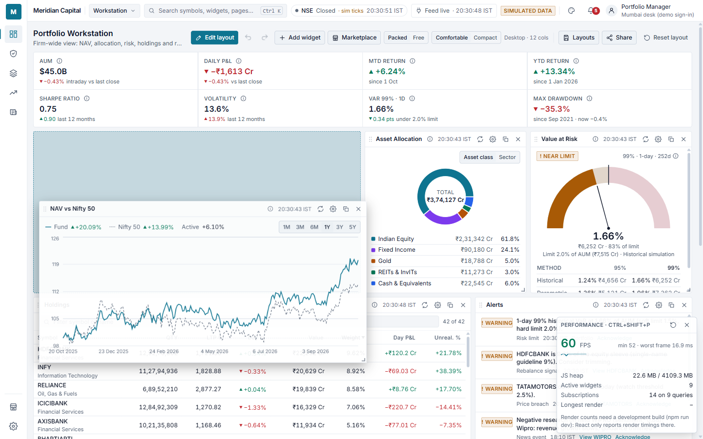

# Performance: method and measurements

> **Dates.** The bundle table was re-measured on 22 Oct 2026. The runtime and Lighthouse
> figures are from 21 Oct 2026, before three later changes: 60 px grid rows, React Router with
> lazy pages, and the Portfolio Summary Strip replacing the overview widget on the Workstation.
> They have not been re-measured since; rerun `scripts/measure-perf.py` before quoting them.

All numbers below were **measured** on the development machine: Windows 11,
Google Chrome launched headless through Playwright (Python), production build served by
`vite preview` on localhost. They are one machine's measurements, not guarantees. Network
latency is the mock API's simulated latency (`VITE_API_LATENCY_MS=180` ± jitter).

## How to reproduce

```bash
npm run build
npx vite preview --port 4173          # terminal 1 (production build)
npx vite --port 5173                  # terminal 2 (dev server, for React Profiler timings)
python scripts/measure-perf.py        # needs: pip install playwright
python scripts/measure-drag-fps.py    # drag FPS, Chrome trace and docs/screenshots/drag-fps.png
npm run analyze                       # bundle sizes and budgets
npx lighthouse http://localhost:4173/#/workstation --preset=desktop
```

## Performance overlay (Ctrl+Shift+P)

A developer overlay for watching the app live, for example to screenshot FPS during a drag.
Press **Ctrl+Shift+P** (⌘+Shift+P on macOS) to toggle it. It samples twice a second:

| Reading                            | Source                                                                                      |
| ---------------------------------- | ------------------------------------------------------------------------------------------- |
| FPS, min, worst frame              | `requestAnimationFrame` timestamps over each 0.5 s window; sparkline of the last 30 s       |
| JS heap                            | `performance.memory` (Chrome and Edge only; other browsers show "not exposed")              |
| Active widgets                     | Widget frames mounted on the page                                                           |
| Subscriptions                      | TanStack Query observers, and the queries they watch                                        |
| Renders per widget, longest render | React Profiler `actualDuration` per widget instance since the overlay opened (reset with ↻) |

Render counts and timings need a **development build** (`npm run dev`): React only reports
Profiler timings there. FPS, heap, widgets and subscriptions work in any build. Render counts
include data refreshes (Holdings and the treemap refresh every 5 s), not only drags. The overlay
itself re-renders twice a second; it lives outside the grid, so it does not re-render widgets.

## Drag FPS check (`scripts/measure-drag-fps.py`, 28 Oct 2026)

Production build in headed Google Chrome 156 (1440 × 900, Windows 11, Intel Core i3-10110U, 60 Hz
display), Workstation page, Performance Overlay open. The NAV widget is held by its title bar and
swept 500 px right and back for 4 s, one pointer move per frame, pushing other widgets as it goes.
Each run records a Chrome performance trace (the same data as DevTools > Performance; the file
loads there with _Load profile_) and counts frames from it and from `requestAnimationFrame`.

| Run | rAF FPS | p95 frame | Worst frame | Trace: frames drawn / BeginFrames | Trace FPS | Dropped frames |
| --- | ------- | --------- | ----------- | --------------------------------- | --------- | -------------- |
| 1   | 59.8    | 16.9 ms   | 33.0 ms     | 255 / 257                         | 60.0      | 8              |
| 2   | 59.0    | 17.6 ms   | 48.2 ms     | 253 / 256                         | 59.4      | 9              |
| 3   | 59.8    | 16.9 ms   | 33.2 ms     | 251 / 253                         | 59.9      | 6              |

All three runs are above 55 FPS. The dropped frames fall in the first ~0.4 s, when the drag
starts (the widget lifts and the target ghost and departure outline appear); after that the
drag holds 60 FPS. Screenshot of run 3, taken with the widget still held:



Notes on method:

- Pointer moves are sent from the page once per animation frame. Sending each move from
  Playwright took ~50 ms on this machine, so most frames had nothing new to draw and the
  trace showed ~29 drawn frames per second while the page itself ran at 59.6 FPS. That
  measured the input rate, not the app.
- Chrome drops a covered or minimised window to 1 FPS. Two runs made while the window was
  hidden read 1 FPS; the script now launches Chrome with
  `--disable-backgrounding-occluded-windows` (as Lighthouse and Puppeteer do) and rejects a
  run if the page was hidden.
- This is one laptop with a 60 Hz display; slower machines or larger layouts may differ.

## Bundle sizes (`npm run analyze`, gzip level 9, 22 Oct 2026)

| Chunk                         | gzip                            | Notes                                                                                       |
| ----------------------------- | ------------------------------- | ------------------------------------------------------------------------------------------- |
| Main entry                    | **114.5 KB**                    | React, React Router, TanStack Query, Zustand, zod, data layer, shell. Budget 150 KB         |
| Dashboard page                | 31.0 KB                         | Grid, react-grid-layout, frame, summary strip; loads with the first dashboard. Budget 50 KB |
| Settings / Marketplace pages  | 3.2 KB / 1.6 KB                 | Lazy routes                                                                                 |
| Each widget chunk             | **0.7–2.1 KB**                  | One `React.lazy` chunk per widget. Budget 50 KB                                             |
| Animation features            | 18.2 KB                         | Framer Motion `domAnimation`, loaded via `LazyMotion` after first paint                     |
| Theme builder                 | 1.6 KB (+3.8 KB react-colorful) | Loaded only when opened                                                                     |
| Shared vendor: Recharts       | 137.3 KB                        | Loaded on the first chart widget; shared by all Recharts widgets                            |
| Shared vendor: D3             | 31.5 KB                         | Scales, arcs, hierarchy (also used by Recharts)                                             |
| Shared vendor: react-virtuoso | 20.7 KB                         | Tables and feeds                                                                            |
| CSS                           | 7.7 KB                          | Tailwind, purged                                                                            |

The per-widget budget is met by the widget code itself. Recharts cannot be split per widget,
so it is a shared lazy vendor chunk that is cached after the first chart loads.

## Runtime (`scripts/measure-perf.py`, 21 Oct 2026, earlier layout)

| Measurement                        | Result                                                                                   | Method                                                                                                                     |
| ---------------------------------- | ---------------------------------------------------------------------------------------- | -------------------------------------------------------------------------------------------------------------------------- |
| Initial load, 10 widgets with data | runs: 1220, 1072, 1124, 1143, 1080 ms (median 1.12 s)                                    | Fresh browser context. Time from navigation start until all 10 widget bodies have rendered content and no skeleton remains |
| Theme switch, click to next paint  | first switch on 5 fresh loads: 96.1, 37.1, 37.0, 64.9, 38.1 ms; later switches ≤ 57.9 ms | Click a theme option, then wait two `requestAnimationFrame`s                                                               |
| Drag                               | 59.8 FPS average, p95 frame 16.8 ms, worst frame 33.2 ms                                 | `requestAnimationFrame` timestamps while dragging the NAV widget across 120 pointer moves                                  |
| Widget re-render on new data       | max 12.5 ms, p95 4.5 ms over 110 updates in 25 s                                         | `React.Profiler` `actualDuration` in the **development** build (slower than production)                                    |

## Lighthouse 12.6

| Preset                             | Performance | Accessibility                                  | Best practices | SEO |
| ---------------------------------- | ----------- | ---------------------------------------------- | -------------- | --- |
| Desktop (3 runs)                   | 98, 99, 99  | 100                                            | 100            | 100 |
| Mobile, 4× CPU throttling (2 runs) | 60, 62      | 95 at the time (button-name issue since fixed) | 100            | 100 |

Desktop Total Blocking Time was 0–10 ms in those runs. The first Lighthouse run right after a
fresh build sometimes scored 64–67 (TBT ~600–1,100 ms). Waiting ~45 s after the build removed
the effect. The project sits in a OneDrive-synced folder, and syncing the new build output is
the likely cause, but this was not proven.

The mobile score reflects a desktop-oriented, chart-heavy workstation rendered under simulated
4× CPU slowdown. Most blocking time there is Recharts layout work for the first charts.

## What was done to get here

- **Code splitting**: every widget is `React.lazy`; Recharts, D3, react-virtuoso and
  react-colorful are separate vendor chunks; Framer Motion features load lazily (`LazyMotion`).
- **Theme switching without React**: tokens are CSS variables written by `applyTheme`. Charts
  use `rgb(var(--token))` in SVG attributes, so no chart re-renders on a theme change. CSS
  transitions are suspended for the frame of the switch (no fade, no flash). A pre-paint script
  applies the cached theme before first paint.
- **Grid**: the grid measures its own width and renders once at the real size (no layout at a
  default width first). Widget bodies are `memo`ised and children are memoised on the id list,
  so dragging re-renders frames, not chart bodies. `useCSSTransforms` is on.
- **Data**: widget bodies take new data via `useDeferredValue` (transition priority), so React
  can spread renders across frames. Responses keep object identity (no structural sharing),
  and derived series are `useMemo`ised.
- **Charts**: line and area charts keep about one point per 3 px (max 300). Date axes use a fixed
  tick interval so Recharts does not measure every label in the DOM. Animations are off for
  data-driven charts.
- **Simulation**: the first request catches the intraday tape up in yielding slices of 1,200 ticks.
- **Accessibility live regions** are throttled to one announcement per 15 s per widget, so
  ticking prices don't flood screen readers (the first summary is immediate).
